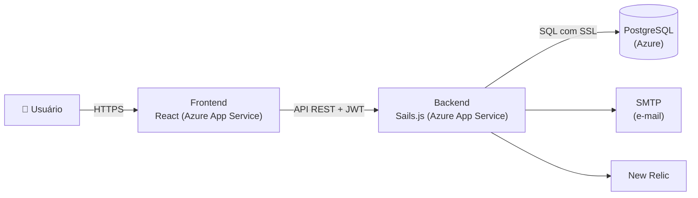

# Quintal da Amora — Plataforma do Evento

Plataforma web para gestão e engajamento dos visitantes do evento **Quintal da Amora**.

O evento enfrentava dificuldades de organização, comunicação e controle das atividades em tempo real: programação espalhada em redes sociais, avisos de última hora que se perdiam, inscrições manuais e nenhum registro de quem compareceu. A plataforma centraliza a gestão do evento, melhora a comunicação e otimiza a experiência dos participantes.

**Aplicação no ar:** https://quintal-amora-web-erfrewcwgyc9hcfc.brazilsouth-01.azurewebsites.net/
**Documentação completa:** [Wiki do projeto](https://github.com/Franciscocosta10/quintal-amora-platform/wiki)

## Funcionalidades

| Participante | Organização (administrador) |
|---|---|
| Programação por dia, com favoritos | Cadastro e edição da programação, com aviso automático quando um horário muda |
| Inscrição em concursos, respeitando prazo e vagas | Concursos com limite de vagas, lista de inscritos e controle de presença |
| Check-in pelo QR Code dos totens | Painel com os totais do evento |
| Avisos em tempo real no sino | Envio de avisos gerais e chamadas de concurso |
| Catálogo de lojas e artistas | Cadastro de expositores |
| Recuperação de senha por e-mail | Gerenciamento de usuários e perfis |

## Stack

| Camada | Tecnologia |
|---|---|
| Frontend | React 19, Vite, Tailwind CSS 4, React Router |
| Backend | Node.js 22, Sails.js 1 (API REST) |
| Banco | PostgreSQL 16 |
| Hospedagem | Azure App Service + Azure Database for PostgreSQL |
| CI/CD | GitHub Actions (lint, testes, cobertura, SonarCloud e deploy automático) |
| Qualidade | ESLint, Mocha/Chai/Sinon, Vitest/Testing Library, SonarCloud |
| Observabilidade | New Relic e rota `/health` |

## Arquitetura



Diagramas C4, modelo de dados e rotas da API estão na [Wiki](https://github.com/Franciscocosta10/quintal-amora-platform/wiki/Arquitetura).

## Estrutura do repositório

```
├── backend/              API REST (Sails.js)
│   ├── api/              controllers, models, policies, helpers e utils
│   ├── config/           rotas, permissões, banco, segurança
│   └── test/unit/        testes do backend
├── frontend/             Interface web (React + Vite)
│   └── src/              pages, components, hooks, services e testes
├── docs/
│   ├── RFC.md            proposta do projeto (documento assinado)
│   └── wiki/             fonte das páginas da Wiki
├── .github/workflows/    pipeline de CI/CD
└── docker-compose.yml    PostgreSQL para desenvolvimento
```

## Rodando localmente

Pré-requisitos: Node.js 22 e Docker.

```bash
docker compose up -d                 # PostgreSQL de desenvolvimento

cd backend && npm install && npm run dev     # API em http://localhost:1337
cd frontend && npm install && npm run dev    # site em http://localhost:5173
```

Antes de rodar, crie os arquivos `.env` do backend e do frontend. O passo a passo completo, com as variáveis e a criação do primeiro administrador, está em [Como Rodar Localmente](https://github.com/Franciscocosta10/quintal-amora-platform/wiki/Como-Rodar-Localmente).

## Testes

| Parte | Comando | Cobertura mínima | Atual |
|---|---|---|---|
| Backend | `cd backend && npm run test:coverage` | 75% | ~88% |
| Frontend | `cd frontend && npm run test:coverage` | 25% | ~76% |

## Deploy

Automático: a cada merge na `main`, o GitHub Actions roda lint, testes e SonarCloud e, se tudo passar, publica o backend e o frontend na Azure. Detalhes em [Deploy e CI/CD](https://github.com/Franciscocosta10/quintal-amora-platform/wiki/Deploy-e-CI-CD).

## Documentação

- [Wiki do projeto](https://github.com/Franciscocosta10/quintal-amora-platform/wiki): requisitos, fluxos de negócio, arquitetura, API, segurança, deploy, testes e decisões técnicas
- [RFC](./docs/RFC.md): proposta original do projeto ([versão no Google Docs](https://docs.google.com/document/d/1LlH1-6CzqvI3EezxPAWkU6ZBoxwEpqQD06bHw8eh-LI/edit?usp=sharing))
- [Backend](./backend/README.md) e [Frontend](./frontend/README.md): detalhes de cada parte
- Política de Privacidade (LGPD): disponível na aplicação, em `/privacidade`

## Licença

[MIT](./LICENSE). As imagens da marca do evento Quintal da Amora pertencem à organização e são usadas com autorização.
