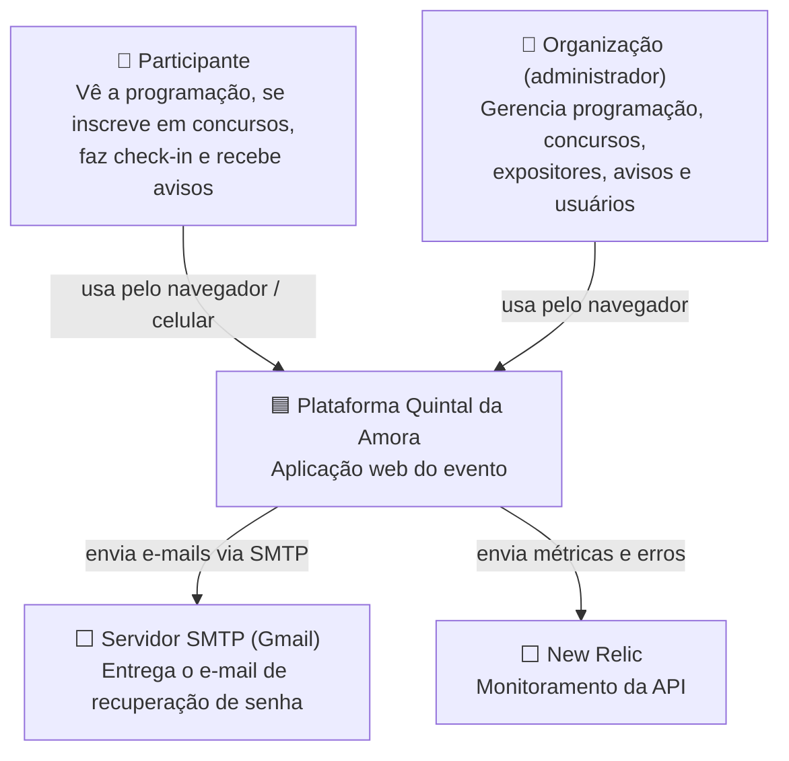
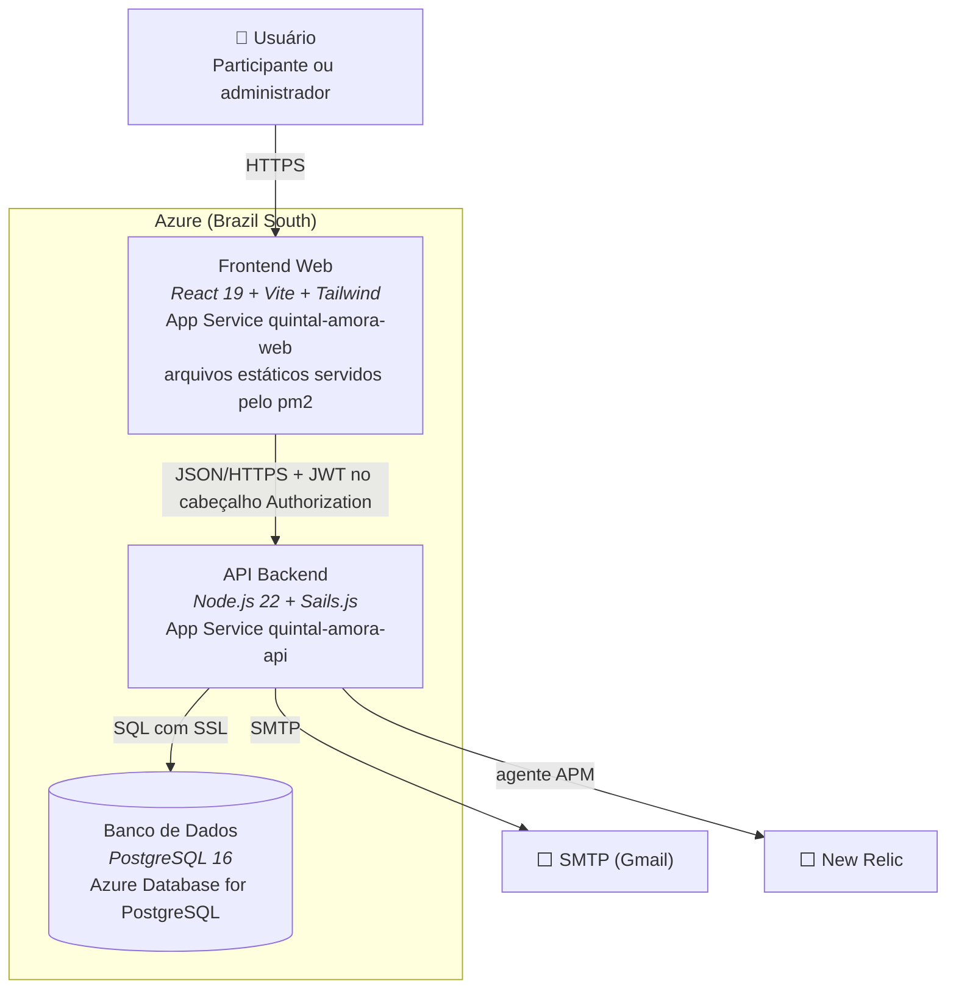
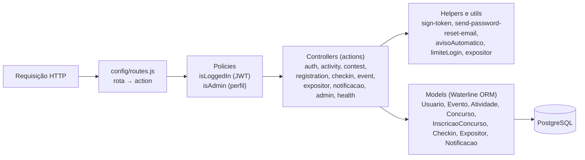
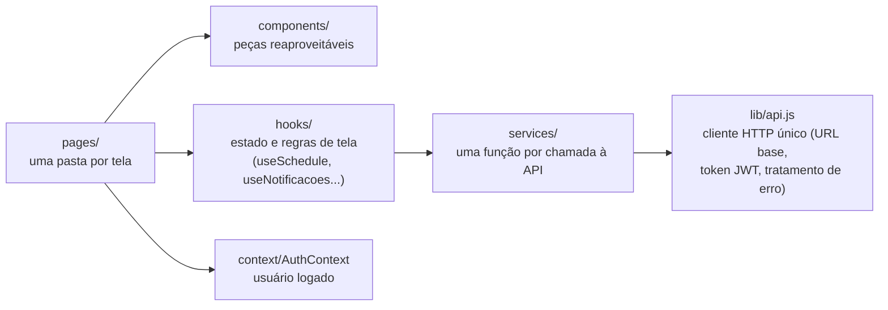

# Arquitetura

A plataforma segue uma arquitetura **cliente-servidor em camadas**:

- um **frontend** React (SPA), que só cuida da interface;
- uma **API REST** em Sails.js, que concentra as regras de negócio e a segurança;
- um banco **PostgreSQL**.

Cada parte é publicada separadamente na Azure.

## C4 — Nível 1: Contexto

## C4 — Nível 2: Containers

Os diagramas da RFC (contexto, containers e componentes) continuam válidos como visão original da proposta. A diferença é que a RFC previa um "serviço externo de notificações". Na implementação, os avisos são internos: ficam no banco e o frontend os busca por polling (ver [Decisões Técnicas](Decisoes-Tecnicas)).

## C4 — Nível 3: Componentes da API

| Componente | Pasta | Responsabilidade |
|---|---|---|
| Rotas | `backend/config/routes.js` | Liga cada URL a uma action |
| Policies | `backend/api/policies/` | Autenticação (`isLoggedIn`) e autorização (`isAdmin`) antes da action |
| Controllers | `backend/api/controllers/<módulo>/` | Uma action por arquivo, com entradas validadas e saídas (`exits`) declaradas |
| Helpers | `backend/api/helpers/` | Funções reaproveitáveis do Sails (gerar JWT, enviar e-mail) |
| Utils | `backend/api/utils/` | Regras compartilhadas entre controllers (aviso automático, limite de login) |
| Models | `backend/api/models/` | Entidades e relacionamentos (ver [Modelo de Dados](Modelo-de-Dados)) |
| Configuração | `backend/config/` | Banco, CORS, segurança, ambiente de produção |

## Organização do frontend

| Pasta | Responsabilidade |
|---|---|
| `src/pages/` | Telas (Home, Programação, Concursos, Catálogo, Check-in, Admin, Login...) |
| `src/components/` | Componentes reaproveitáveis (Layout, Sidebar, Header, modais, formulários, cards) |
| `src/hooks/` | Lógica de estado de cada tela, separada da interface |
| `src/services/` | Chamadas à API, uma função por endpoint |
| `src/lib/api.js` | Único ponto que fala com a API: monta a URL, envia o token e padroniza os erros |
| `src/context/` | Contexto de autenticação (usuário logado, login, logout) |

## Caminho de uma requisição

Exemplo: o participante clica em **Inscrever-se** num concurso.

1. O botão em `components/contest/ContestItem.jsx` avisa a página `pages/contest/Contests.jsx`, que chama `inscreverEmConcurso()` em `services/Registration.js`.
2. `lib/api.js` faz `POST https://<api>/contest/12/register` com o cabeçalho `Authorization: Bearer <token>`.
3. Na API, `config/routes.js` direciona para a action `registration/create`.
4. A policy `isLoggedIn` valida o JWT e carrega o usuário do banco em `req.usuario`.
5. A action `registration/create.js` aplica as regras (aberto, período, duplicidade, vagas) e grava com o model `InscricaoConcurso`.
6. O Waterline gera o `INSERT` parametrizado no PostgreSQL.
7. A resposta JSON volta, a página recarrega as inscrições do usuário (`useMyRegistrations`) e mostra o modal de inscrição confirmada.

Se algo dá errado, a action responde com o código e a mensagem adequados (por exemplo, `400` "Vagas Esgotadas"). `lib/api.js` transforma isso em um `Error` com a mensagem pronta para mostrar.
