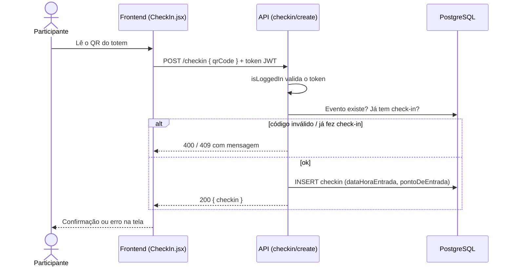
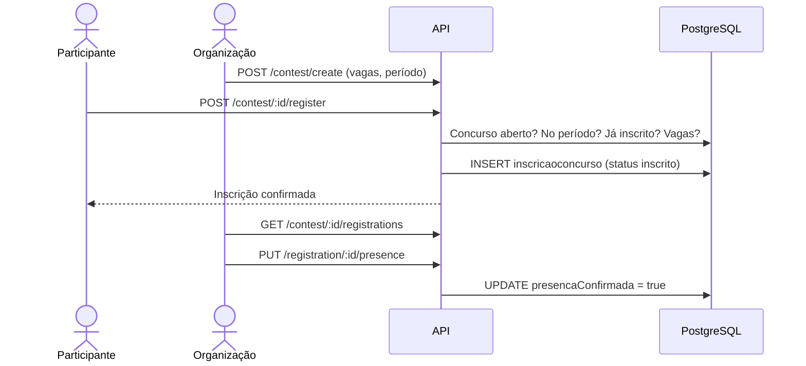
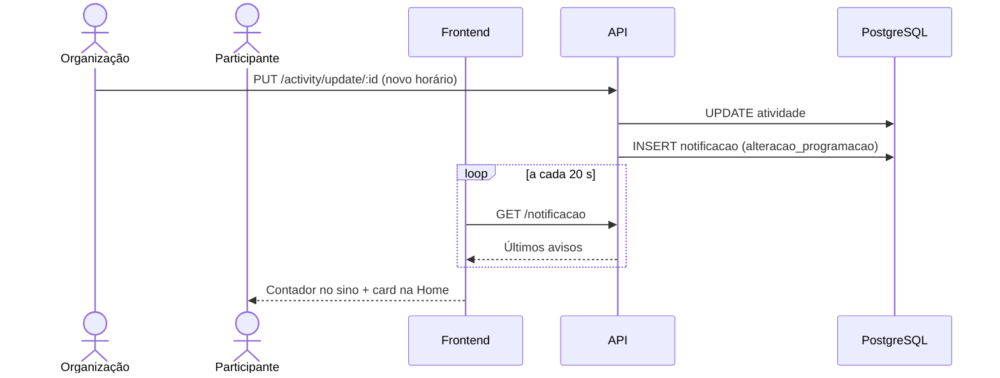

# Fluxos de Negócio

A plataforma tem quatro fluxos de negócio completos, que vão da tela até o banco de dados e voltam com uma resposta para o usuário. Cada um é descrito abaixo com o caminho no código.

---

## 1. Check-in por QR Code (RF04, RF05)

**Quem:** participante. **Objetivo:** registrar a entrada no evento sem fila.

1. Nos totens do evento há um QR Code com um link para a tela de check-in, por exemplo:
   `https://<site>/checkin?qr=checkin:evento:3:ponto:Entrada Principal`.
2. O participante lê o QR com a câmera do celular. Se não estiver logado, passa pelo login ou cadastro e **volta para o mesmo link**, com o código preservado (`ProtectedRoute` guarda o destino).
3. Também é possível ler o QR pela própria tela de check-in, que abre a câmera (`html5-qrcode`).
4. O frontend chama `POST /checkin` com o código (`services/checkinApi.js`).
5. O backend (`checkin/create.js`):
   - confere o formato do código (`checkin:evento:<id>`);
   - confere se o evento existe;
   - recusa se o usuário **já fez check-in** nesse evento (`409`);
   - grava o `Checkin` com o horário de entrada e o ponto (totem) usado.
6. A tela mostra a confirmação, e a aba **Histórico** lista os check-ins do usuário (`GET /checkin/historico`).

---

## 2. Inscrição em concurso e controle de presença (RF08, RF10)

**Quem:** participante e organização. **Objetivo:** organizar os concursos com limite de vagas e saber quem compareceu.

1. O administrador cria o concurso com **período de inscrição** e **limite de vagas** (`contest/create.js`).
2. O participante abre **Concursos** e clica em **Inscrever-se** (`services/Registration.js` → `POST /contest/:id/register`).
3. O backend (`registration/create.js`) recusa a inscrição se:
   - o concurso não está `aberto`;
   - a inscrição ainda não abriu ou já encerrou;
   - o usuário já está inscrito;
   - as vagas acabaram ("Vagas Esgotadas").
4. A inscrição é gravada com status `inscrito`. O card do concurso passa a mostrar que o usuário está inscrito, com a opção de cancelar (o frontend busca as inscrições do usuário em `GET /registration/mine`). Quando restam poucas vagas, o card avisa.
5. O participante pode cancelar. O status muda para `cancelado` e a vaga volta a ficar livre (`registration/cancel.js`).
6. No dia, o administrador abre a **lista de inscritos** e marca quem está presente (`PUT /registration/:id/presence`).
7. O total de inscrições aparece no **painel admin**.

---

## 3. Gestão da programação com aviso automático (RF06, RF07, RF09, RF11)

**Quem:** organização e participantes. **Objetivo:** manter a programação atualizada e avisar todo mundo quando algo muda.

1. O administrador cadastra ou edita uma atividade na tela **Programação** (`activity/create.js`, `activity/update.js`).
2. Se a edição **mudou o horário**, o backend cria um aviso automático do tipo `alteracao_programacao` (`api/utils/avisoAutomatico.js`). O mesmo vale para concursos, com o tipo `chamada_concurso`.
3. O administrador também pode enviar avisos manuais pelo painel admin (`POST /notificacao/create`).
4. No navegador dos participantes, o hook `useNotificacoes` consulta `GET /notificacao` **a cada 20 segundos** (polling).
5. O sino mostra um contador de avisos novos, e a Home exibe os mais recentes no card **Avisos Importantes**.

---

## 4. Recuperação de senha por e-mail

**Quem:** qualquer usuário. **Objetivo:** voltar a acessar a conta sem depender da organização.

1. Na tela **Esqueceu a senha?**, o usuário informa o e-mail (`POST /auth/forgot-password`).
2. O backend gera um token aleatório, guarda **só o hash** dele com validade de 30 minutos e envia o link por e-mail via SMTP (`api/helpers/send-password-reset-email.js`).
3. A resposta é sempre a mesma, exista ou não a conta, para não revelar quais e-mails estão cadastrados.
4. O usuário abre o link, define a nova senha (`POST /auth/reset-password`) e o token é invalidado.
