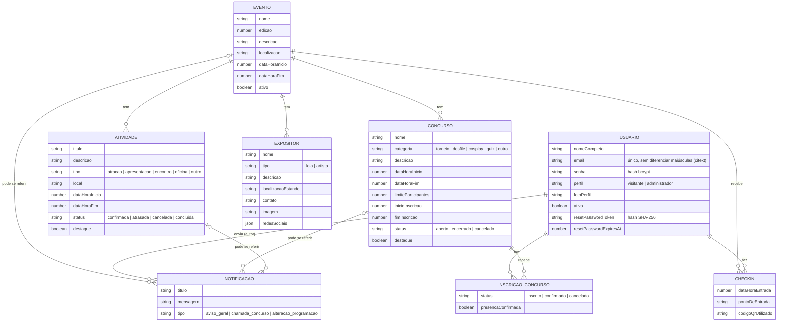

# Modelo de Dados

Os models ficam em `backend/api/models/` e usam o ORM **Waterline** do Sails sobre **PostgreSQL**. Datas e horários são guardados como número (epoch em milissegundos). Todo model tem também `id`, `createdAt` e `updatedAt`.

## Diagrama

## Entidades

| Entidade | Arquivo | Para que serve |
|---|---|---|
| Usuario | `Usuario.js` | Conta de acesso. A senha vira hash bcrypt no `beforeCreate`/`beforeUpdate` e nunca sai nas respostas (`customToJSON`) |
| Evento | `Evento.js` | Edição do evento. O "evento atual" é o mais recente cadastrado |
| Atividade | `Atividade.js` | Item da programação |
| Concurso | `Concurso.js` | Concurso com período de inscrição e limite de vagas |
| InscricaoConcurso | `InscricaoConcurso.js` | Ligação usuário ↔ concurso, com status e presença |
| Checkin | `Checkin.js` | Entrada do usuário no evento, com horário e totem |
| Expositor | `Expositor.js` | Loja ou artista do catálogo |
| Notificacao | `Notificacao.js` | Aviso exibido no sino e na Home (manual ou automático) |

## Schema e migrations

- **Em desenvolvimento**, o Sails cria e ajusta as tabelas sozinho a partir dos models (`migrate: 'alter'` em `config/models.js`).
- **Em produção**, o Sails nunca altera o banco (`migrate: 'safe'` em `config/env/production.js`), para não perder dados. Quando um model muda, as tabelas da Azure são atualizadas rodando o backend uma vez em modo de desenvolvimento apontando para o banco da Azure. O passo a passo está em [Deploy e CI/CD](Deploy-e-CI-CD).
- O e-mail usa o tipo `citext` do PostgreSQL, para que `Ana@Email.com` e `ana@email.com` sejam o mesmo usuário.

## Como adicionar um campo novo (exemplo)

Para adicionar, por exemplo, um campo `instagram` ao expositor:

1. **Model:** incluir o atributo em `backend/api/models/Expositor.js`.
2. **Banco:** em dev, o `migrate: 'alter'` cria a coluna ao subir o backend. Em produção, seguir o passo de atualização das tabelas.
3. **API:** aceitar o campo nas actions `expositor/create.js` e `expositor/update.js` (em `inputs`) e incluí-lo na lista de campos tratados por `api/utils/expositor.js` (`CAMPOS_TEXTO_OPCIONAIS`), que normaliza os dados antes de gravar.
4. **Frontend:** incluir o campo no formulário `components/catalog/ExpositorForm.jsx` e exibi-lo em `ExpositorDetailModal.jsx`.
5. **Testes:** atualizar os testes das actions e do formulário.
