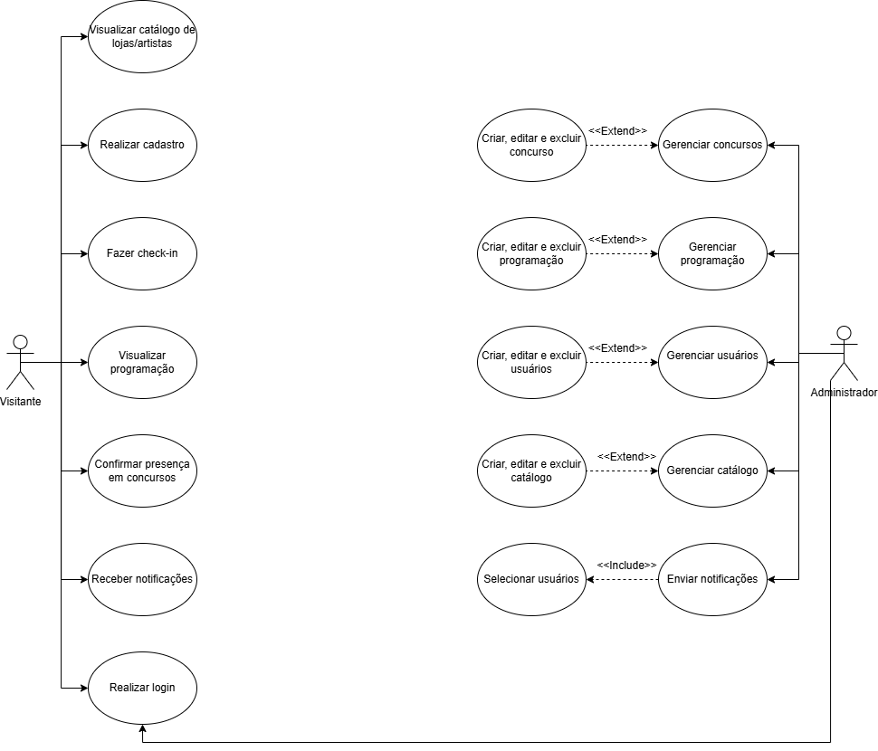

# Requisitos e Casos de Uso

Os requisitos abaixo são os da [RFC](https://github.com/Franciscocosta10/quintal-amora-platform/blob/main/docs/RFC.md), seção 2.3. A coluna **Onde está** aponta o código que implementa cada um, para facilitar a conferência.

## Requisitos funcionais

### Usuários e acesso

| RF | Requisito | Situação | Onde está |
|---|---|---|---|
| RF01 | Cadastro de usuários | ✅ Implementado | `backend/api/controllers/auth/signup.js`, `frontend/src/pages/auth/SignupPage.jsx` |
| RF02 | Login e logout | ✅ Implementado | `auth/login.js`, `auth/logout.js`, `frontend/src/context/AuthContext.jsx` |
| RF03 | Perfis visitante e administrador | ✅ Implementado | Campo `perfil` em `models/Usuario.js`, policy `api/policies/isAdmin.js` |

Além da RFC: recuperação de senha por e-mail (`auth/forgot-password.js`, `auth/reset-password.js`), edição de perfil e foto, e bloqueio temporário após várias senhas erradas (`api/utils/limiteLogin.js`).

### Check-in

| RF | Requisito | Situação | Onde está |
|---|---|---|---|
| RF04 | Check-in por QR Code | ✅ Implementado | `checkin/create.js`, `frontend/src/pages/checkin/CheckIn.jsx` (leitura pela câmera com `html5-qrcode`) |
| RF05 | Registrar o horário de entrada | ✅ Implementado | Campo `dataHoraEntrada` em `models/Checkin.js`, histórico em `checkin/historico.js` |

### Programação

| RF | Requisito | Situação | Onde está |
|---|---|---|---|
| RF06 | Exibir a programação completa | ✅ Implementado | `activity/find.js`, `frontend/src/pages/schedule/Schedule.jsx` |
| RF07 | Administrador cadastra e edita a programação | ✅ Implementado | `activity/create.js`, `activity/update.js`, `activity/delete.js` |

### Concursos

| RF | Requisito | Situação | Onde está |
|---|---|---|---|
| RF08 | Confirmação de presença (inscrição) em concursos | ✅ Implementado | `registration/create.js`, `registration/cancel.js` |
| RF09 | Avisar sobre horários das atividades | ✅ Implementado | `api/utils/avisoAutomatico.js`: quando o horário de uma atividade ou concurso muda, o sistema cria um aviso automaticamente |
| RF10 | Gerenciar a lista de participantes | ✅ Implementado | `registration/find.js`, `registration/presence.js`, `frontend/src/components/contest/RegistrationsModal.jsx` |

### Notificações

| RF | Requisito | Situação | Onde está |
|---|---|---|---|
| RF11 | Notificações sobre eventos e atividades | ✅ Implementado | `notificacao/create.js`, `notificacao/find.js`, sino em `frontend/src/components/NotificationBell.jsx` |
| RF12 | Alertas de chamada para concursos | ✅ Implementado | Tipo `chamada_concurso` em `models/Notificacao.js` |

### Catálogo de lojas e artistas

| RF | Requisito | Situação | Onde está |
|---|---|---|---|
| RF13 | Listar lojas e artistas | ✅ Implementado | `expositor/find.js`, `frontend/src/pages/catalog/Catalog.jsx` |
| RF14 | Ver as informações de cada expositor | ✅ Implementado | `GET /expositor/:id`, `frontend/src/components/catalog/ExpositorDetailModal.jsx` |
| RF15 | Cadastro e edição pelo administrador | ✅ Implementado | `expositor/create.js`, `expositor/update.js`, `expositor/destroy.js` |

### Administração

| RF | Requisito | Situação | Onde está |
|---|---|---|---|
| RF16 | Painel administrativo | ✅ Implementado | `admin/dashboard.js`, `frontend/src/pages/admin/AdminDashboard.jsx` |
| RF17 | Gerenciar usuários | ✅ Implementado | `admin/user-create.js`, `admin/user-update.js`. "Remover" é feito desativando a conta (campo `ativo`), para não apagar o histórico de check-ins e inscrições |
| RF18 | Gerenciar o evento (dados, programação, concursos, avisos) | ✅ Implementado | `event/save.js` e as telas de programação, concursos e avisos |

## Regras de negócio

| Regra | Como foi implementada |
|---|---|
| **Só administradores alteram a programação e enviam avisos** | Rotas de escrita protegidas pelas policies `isLoggedIn` + `isAdmin` (`config/policies.js`). No frontend, os botões de edição só aparecem para administradores |
| **Programação e concursos são públicos para leitura** | `activity/find`, `contest/find`, `expositor/find` e `notificacao/find` liberados sem login |
| **Check-in uma única vez por evento** | `checkin/create.js` recusa um segundo check-in do mesmo usuário no mesmo evento (resposta `409`) |
| **QR Code no formato do evento** | O QR precisa seguir o formato `checkin:evento:<id>` (opcionalmente `:ponto:<nome do totem>`). Qualquer outro conteúdo é recusado |
| **Inscrição só no período e com vagas** | `registration/create.js` recusa a inscrição se o concurso não está `aberto`, se está fora do período de inscrição, se o usuário já está inscrito ou se as vagas acabaram |
| **Cancelar não apaga** | O cancelamento muda o status para `cancelado`. A vaga volta a ficar livre e o histórico é preservado |
| **Mudança de horário gera aviso** | Ao editar o horário de uma atividade ou concurso, `avisoAutomatico.js` cria um aviso para todos |

## Casos de uso

O diagrama de casos de uso está na RFC (seção 2.2):

### User stories

**Participante**
- Como participante, quero **ver a programação por dia** para planejar o que vou assistir.
- Como participante, quero **favoritar atividades e concursos** para encontrá-los rápido.
- Como participante, quero **me inscrever em um concurso** e saber na hora se ainda há vagas.
- Como participante, quero **fazer check-in lendo o QR Code** do totem, sem fila.
- Como participante, quero **receber avisos** de atrasos e chamadas sem precisar recarregar a página.
- Como participante, quero **conhecer as lojas e artistas** e acessar as redes sociais deles.
- Como participante, quero **recuperar minha senha por e-mail** se eu esquecer.

**Organização (administrador)**
- Como organizadora, quero **cadastrar e editar a programação**, e que os participantes sejam avisados quando um horário mudar.
- Como organizadora, quero **criar concursos com limite de vagas e período de inscrição**.
- Como organizadora, quero **ver os inscritos e marcar a presença** de cada um no dia.
- Como organizadora, quero **enviar avisos** gerais ou de chamada de concurso.
- Como organizadora, quero **ver os totais do evento** (check-ins, inscrições, expositores) em um painel.
- Como organizadora, quero **criar contas e desativar usuários**.

## Fora do escopo

Conforme a RFC (seção 2.6): venda de ingressos, rede social integrada, pagamentos e chat entre usuários.
